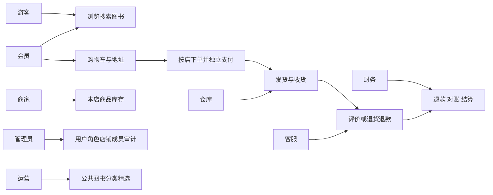
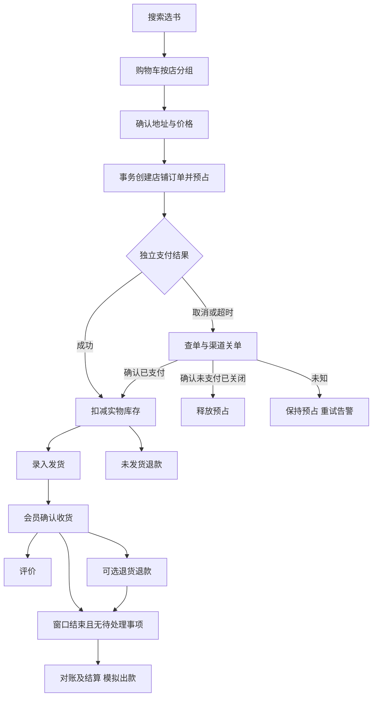

# 阅集图书商城总需求文档

版本：1.0｜性质：需求基线｜关联：02 系统设计、11 要求追踪矩阵。

## 1 项目背景和目标

原始依据为《实验四：【项目实战】企业级应用——XX商城系统.docx》中的“实验目的”和“实验步骤展示”第 1—6 项。原文要求真实商城业务闭环、前后端分离、统一 API、企业级安全与一致性、可验证质量、AI 留痕和可复现交付，不要求把所有示例技术都堆进系统。

本项目命名为“阅集图书商城”，服务于购买实体新书的读者、中小书店和平台工作人员。目标是让读者完成找书、购买、收货和售后，让商家管理商品库存及履约，让平台完成监管、退款审核、对账与结算。

成功条件：正常购买和售后闭环可演示；商家不能操作他店数据；库存、支付、退款和结算能够承受重复请求；新环境可按文档复现；设计、实现、测试和 AI 决策可追溯。本文件中的性能和可用性数值均是验收目标，不是已测结果。

## 2 用户画像和范围

| 用户 | 场景与痛点 | 本期解决方式 |
|---|---|---|
| 学生和普通读者 | 按书名、作者、ISBN 找书，担心库存及订单进度不准 | 可搜索资料、店铺报价、实时下单校验和订单时间线 |
| 中小书店负责人 | 同一本书有不同库存价格，线上线下调整需留痕 | 店铺商品、SKU、库存调整及审计 |
| 仓库人员 | 只应看到本店待发货订单，避免误发已退款商品 | 店铺范围和可发货数量校验 |
| 客服与财务 | 售后证据不完整、退款重复、结算不清 | 售后流程、退款流水和结算明细 |
| 平台管理员 | 授权混乱、故障缺乏定位资料 | RBAC、审计、traceId、指标和告警 |

### 2.1 本期必做

实体新书、多店铺、人民币交易、国内单一收货地址；公共图书目录与商家销售 SKU；后台创建商家和店铺；浏览搜索、购物车、拆单、支付、库存预占、物流录入、收货、退款退货、评价、结算；测试、CI/CD、监控、备份恢复和 AI 使用记录。

### 2.2 明确排除

电子书授权、二手交易、商家自助入驻审核、跨境税务、真实商家出款、真实物流接口、发票、积分、优惠券、秒杀、推荐算法、跨店合并支付和微服务拆分。首页推荐为人工精选，不构成算法推荐。系统保留扩展边界，但这些功能不进入首版表、接口和验收。

## 3 术语

| 术语 | 定义 |
|---|---|
| Book | 一种确定 ISBN/版本的公共图书资料 |
| Product | 一家店铺针对某本图书建立的商品展示信息 |
| SKU | Product 下唯一的可售单位；首版每个 Product 只有一个 SKU，同 ISBN 不同商家可分别销售 |
| Checkout batch | 一次跨店提交产生的订单集合，不是合并支付单 |
| Order | 单一店铺、单一币种、单一地址的一笔交易 |
| Payment | 与一个订单一对一的支付尝试记录；网络重试复用原渠道交易号 |
| Reservation | 下单后尚未完成扣减或释放的库存预占 |
| After sale | 按订单行及数量申请的退款或退货退款 |
| Settlement | 平台与一家店铺某个周期的应结金额账单；本期出款为模拟 |

## 4 角色权限矩阵

“本人”按用户 ID；“本店”按服务端有效店铺成员关系；“平台”仅授予明确的操作权限。默认拒绝，前端隐藏入口不代替授权。同一账号可以有多个角色，但不得通过请求传入 role 或 shopId 获得授权。

| 能力 | 游客 | 会员 | 商家 | 仓库 | 运营 | 客服 | 财务 | 管理员 |
|---|---|---|---|---|---|---|---|---|
| 浏览上架商品、公开评价 | 允许 | 允许 | 允许 | 允许 | 允许 | 允许 | 允许 | 允许 |
| 购物车、地址、购买、评价 | — | 本人 | 需会员角色 | — | — | — | — | — |
| 商品与 SKU 维护、库存调整 | — | — | 本店 | — | 下架违规商品 | — | — | — |
| 查看订单、录入发货 | — | 本人只读 | 本店 | 本店 | — | 平台售后所需只读 | 财务字段只读 | — |
| 公共图书、分类、精选维护 | — | — | 只读选择 | — | 平台 | — | — | — |
| 申请售后、提交退货运单 | — | 本人 | — | — | — | — | — | — |
| 审核售后 | — | — | 查看本店 | — | — | 平台 | — | — |
| 验收退货及是否可再售 | — | — | 查看本店 | 本店 | — | 查看 | — | — |
| 执行退款、对账、结算 | — | — | 本店账单只读 | — | — | 查看进度 | 平台 | — |
| 用户、角色、店铺成员、审计 | — | — | — | — | — | — | — | 平台 |

管理员不是默认业务超级用户；如需业务操作必须显式授予对应权限并产生审计。退款执行人、结算批准人与原售后审核人或结算创建人分离；演示种子数据提供独立账号。

## 5 功能需求与验收条件

| 编号 | 需求和主流程 | 异常与验收要求 |
|---|---|---|
| FR-01 | 用户名密码注册、登录、刷新、退出；后台用户禁用和 RBAC | 密码不明文；退出或禁用后不能刷新；关键写接口及时检查禁用状态；他人资源不可访问 |
| FR-02 | 按书名、作者、ISBN 搜索，分类筛选、价格排序、图书详情及评价 | 下架商品不出现在公开列表；已有订单快照不受商品变更影响；分页稳定 |
| FR-03 | 运营维护公共图书资料，商家创建本店 Product 与 SKU、维护价格库存、上下架 | ISBN 不重复；同店同书仅一个 Product；不得调整库存至低于预占量 |
| FR-04 | 会员管理购物车、收货地址，按店铺分组勾选结算 | 同 SKU 合并数量；地址归属校验；下架或缺货项明确提示并阻止提交 |
| FR-05 | 预览费用，提交后按店拆单，生成每店独立订单 | 订单创建及全部预占同事务成功或失败；价格变化要求重新预览；重复提交返回原批次 |
| FR-06 | 每订单独立支付，支持支付宝沙箱和开发测试模拟 | 回调验签及金额核对；重复回调仅生效一次；页面回跳不能直接改为已支付 |
| FR-07 | 下单预占、支付扣减、未支付取消及超时释放 | 超卖和负库存为零；支付与关单竞争必须收敛；渠道状态未知时不得直接释放 |
| FR-08 | 本店发货、录入物流、会员确认收货，展示时间线 | 首版每订单一次整体发货；排除已退款数量；有未结束售后时暂停发货；仅本人可收货 |
| FR-09 | 未发货退款、完成后退货退款、审核、退货验收、退款执行 | 可退数量扣除已退和处理中数量；退款累计不超实付；失败可重试而不重复退款 |
| FR-10 | 完成订单后针对订单行评价并展示 | 每订单行一条、评分 1—5；已全额退款行不能新增评价；运营可隐藏违规评价并留痕 |
| FR-11 | 财务核对渠道支付退款，形成按店结算单，审核后模拟出款 | 售后未结束不入结算；同订单只入一个正常结算单；账不平禁止出款；商家只看本店 |
| FR-12 | 用户角色、店铺成员、审计、健康状态与业务监控 | 权限改动、退款、库存调整、结算均可追查操作者与 traceId；管理接口不公开 |
| FR-13 | 文件上传支撑封面及售后凭证 | 限制大小、类型和归属；私有售后凭证不能由公开静态路径访问 |

## 6 统一业务政策

以下均为本项目设计决策，后续模型不得自行更改。

1. 全站人民币、包邮；运费字段保留快照值 0.00。没有促销折扣，订单金额为各行单价乘数量之和。商品价格必须大于 0，数量为 1—99 的整数，每次结算最多 50 个 SKU。
2. 一次结算在一个本地事务内创建全部店铺订单并预占库存，任意商品不满足条件则全部失败。每个订单独立付款或取消，不影响其他店铺订单。
3. 预览有效期 5 分钟；有效期内也不锁价格库存。提交时对比预览版本和金额，有变化返回冲突，要求用户重新确认，不静默涨价。
4. 待支付有效期 30 分钟。时间从订单建立计，展示倒计时以服务端截止时间为准。关单与查单成功确认后才释放库存；渠道异常期间保持关闭处理中并报警。
5. 库存表示现有实物量与预占量；支付成功同时减少实物量和预占量。未支付取消只减少预占量。发货不再扣一次库存。未发货退款成功回补库存；收货后退货由仓库验收判定可再售才回补。
6. 未发货且已支付可申请 REFUND_ONLY；确认收货后 7×24 小时内可申请 RETURN_REFUND。已发货未收货期间不受理退款申请；页面说明可收货后申请退货，不做仅退款物流纠纷。
7. 售后按订单行申请，可选择部分数量；每行同一时刻最多一个进行中的申请。退款金额为快照单价乘批准数量。审核只能整笔同意或拒绝申请，不由后台任意改金额。
8. 退货审核通过后 7 天内填写运单，否则申请过期结束；已寄回则不得仅因内部超时自动拒绝，转人工待处理。拒绝、撤销、过期后释放可申请数量，成功退款的数量永久累计。
9. 首版不自动确认收货、不支持拆包或补发。对已支付未发货订单，全量退款完成后关闭；部分退款后仅剩余数量可发货。
10. 平台服务费为可结商品净额的 3%，每订单计算并四舍五入至分。售后窗口结束且无进行中售后、退款或对账差异后可结算。按自然日北京时间生成账期，同日同店一个结算单；出款仅模拟。
11. 评价窗口为确认收货后 30 天；有未退款数量即可评价。评价不允许修改或删除，运营可以隐藏。评价不阻止售后；后续退款不删除历史评价。
12. 店铺暂停营业阻止新下单，但已有订单、售后、退款和结算继续履行。用户禁用不能抹除已有债务或交易记录，由授权客服协助处理。

## 7 需求视图

该图作为角色用例视图，各用例的主流程及异常条件以第 5 节为准。

领域关系：用户拥有地址和购物车；公共图书归属分类，店铺通过 Product/SKU 销售图书；结算批次包含店铺订单；订单拥有订单行、支付、物流、售后及状态日志；库存属于 SKU；退款归属售后；结算明细归属订单。详细 ER 关系见 03，接口总表见 04。

## 8 非功能需求

| 编号 | 目标 | 验证口径 |
|---|---|---|
| NFR-01 性能 | 商品查询 P95≤500ms，内部下单 P95≤800ms，意外 5xx/超时率<1% | 4 vCPU/8GB Linux SSD，应用及基础中间件同机；监控与压测机独立；10,000 本书、20,000 SKU、100,000 历史订单；预热 5 分钟后测 10 分钟，查询 80 RPS＋创建订单 20 RPS；不把支付宝耗时算入内部接口 |
| NFR-02 一致性 | 无超卖、重复扣款入账、重复退款入账或重复结算 | 单 SKU 最后 10 本被 100 个独立用户并发购买，重复请求与回调各重放 20 次；校验持久化账目 |
| NFR-03 安全 | 匿名、水平越权、垂直越权被拒绝；密码和私钥不出日志；无未处理高危漏洞 | 权限矩阵用例、依赖扫描、SQL 参数化和 XSS/CSRF 检查，例外须记录到期和负责人 |
| NFR-04 可恢复性 | RPO≤24 小时，RTO≤60 分钟；依赖恢复后积压事件≤5 分钟开始继续处理 | 数据集不超过 5GB 的备份恢复演练；记录实际恢复点及耗时，目标失败如实报告 |
| NFR-05 可观测性 | 核心请求可按 traceId 追踪；队列积压、支付关闭滞留和高错误率可告警 | 人工注入故障并保存日志、看板及告警证据；禁用高基数敏感标签 |
| NFR-06 可维护性 | 核心服务分支覆盖率≥80%；所有已设计操作都有契约测试 | 覆盖率报告与接口操作编号对照；模块不能绕过其他模块服务直接修改其业务表 |
| NFR-07 可复现 | 依赖预备完毕后，空数据环境 30 分钟内完成部署并可登录 | 由未参与开发者按部署说明操作；外网下载和账号审批时间单独记录 |
| NFR-08 可用性 | 测试环境连续 24 小时有效探测成功率≥99% | 每分钟探测就绪与读接口；按探测次数计算；不宣称为生产 SLA，单机维护窗口单列 |

## 9 验收入口和变更管理

每项功能必须有页面或可解释的后台入口、接口、持久化设计、异常处理及验收证据。完整实现不以“页面存在”或“接口返回成功”判断，而以订单、库存、流水和权限的最终状态判断。

需求变更应写明编号、理由、影响的页面/接口/表/测试、旧数据兼容性和决策人。先更新本文件及相关设计，再修改实现。本次文档编制不承诺已达到上述运行指标。
