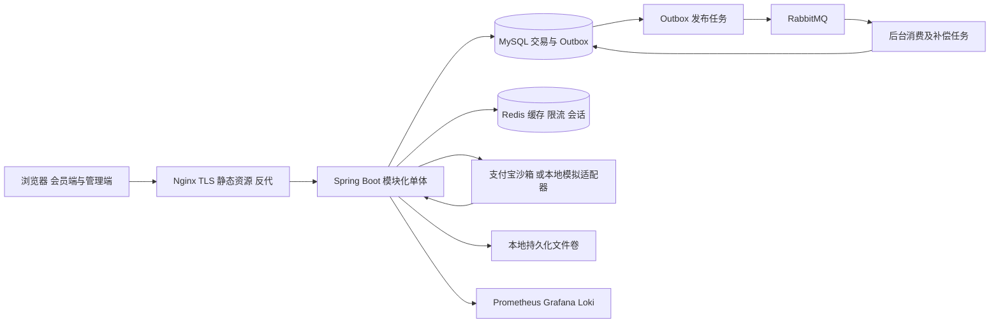
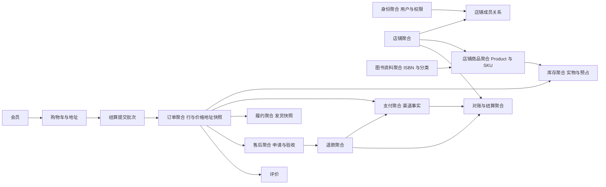
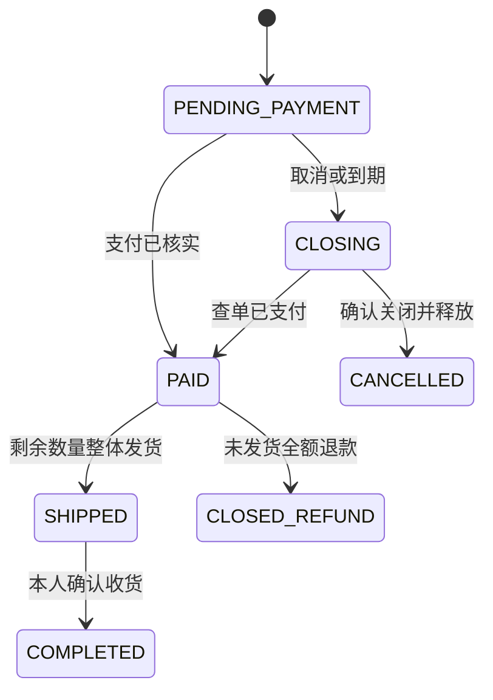
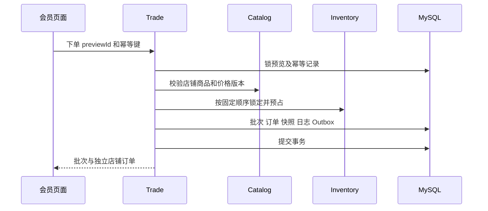

# 阅集图书商城系统设计文档

版本：1.0｜业务政策以 01 为准，持久化和网络契约分别见 03、04。

## 1 架构与工程边界

采用模块化单体。浏览器只通过 JSON 业务接口访问后端，前端工程独立构建。后端按领域分模块，模块内部遵守 Controller → Service → Repository；数据库事务位于 Service。Controller 负责输入与身份上下文，不能计算金额或直接操作数据库。Repository 只负责持久化，不能调用支付渠道。

支付宝通知、文件字节传输和监控端点是外部协议例外，不能被统一 JSON 规范破坏。首版无需注册中心、Spring Cloud Gateway 或 Kubernetes；Nginx 提供反向代理、TLS 和静态页面。

工程规划为 backend、frontend、infra、docs 四个顶层目录；本次仅编写 docs。frontend 内以会员布局和管理布局分路由，使用同一个 Vue 工程，避免两套业务契约。未来代码、数据库迁移和运维文件均不得藏在设计文档目录中。

## 2 模块职责与调用方向

| 模块 | 所有的数据及职责 | 调用边界 |
|---|---|---|
| identity | 用户、角色、权限、店铺成员、会话 | 向其他模块提供可信用户及权限上下文 |
| catalog | 分类、公共图书、Product、SKU、精选 | 查询价格和上架状态；不负责交易金额快照 |
| cart | 购物车、地址 | 提供会员选择，不修改订单 |
| trade | 预览、批次、订单行、状态日志 | 协调 catalog、inventory 和 payment；持有订单状态机 |
| inventory | 库存、预占、变更流水 | 提供预占、扣减、释放、回补，拒绝外部直接写表 |
| payment | 支付、渠道事件、退款、对账 | 渠道适配、验证和财务状态；通过服务协同 trade |
| fulfillment | 发货及物流展示 | 校验可发货数量；协同 trade 完成发货收货 |
| aftersales | 售后、审核、退货验收 | 使用订单快照校验数量金额，请求 payment 退款 |
| review | 评价、违规隐藏 | 读取履约和退款结果判断资格 |
| settlement | 结算单、明细和调整 | 消费财务事实并复核订单，只模拟出款 |
| platform | 审计、文件元数据、运行任务、Outbox | 不承载商品或交易业务规则 |

跨模块读可使用明确的查询接口；写必须由所属模块服务控制。单体内库存预占和订单落库共享 MySQL 本地事务，不制造伪分布式事务。异步消息用于通知、投影和可重试任务；成功下单不依赖消息队列即时在线。

### 领域模型视图

箭头表达业务依赖，不代表任意跨模块写表权限；资金事实由 payment 管理，订单业务状态由 trade 管理，结算只引用已核实的交易事实。

## 3 核心状态机

状态枚举使用下列英文值，页面显示中文。状态、支付状态、售后状态分别存储，不能用一个“已完成”覆盖所有维度。

### 3.1 订单

| 当前状态 | 触发条件 | 下一个状态与副作用 |
|---|---|---|
| PENDING_PAYMENT | 核实支付成功 | PAID；预占转实物扣减；写状态日志 |
| PENDING_PAYMENT | 用户取消或到期 | CLOSING；停止新支付请求，异步查单与关单 |
| CLOSING | 渠道确认未付且关闭，或确认从未向渠道发起交易 | CANCELLED；释放预占一次 |
| CLOSING | 渠道确认已支付 | PAID；扣减预占，取消未成功，向会员明确提示 |
| CLOSING | 查询未知或超时 | 保持 CLOSING；重试告警，禁止提前释放 |
| PAID | 全部未发货数量完成退款 | CLOSED_REFUND；没有剩余发货数量 |
| PAID | 无进行中售后，剩余数量全部发货 | SHIPPED；生成唯一发货记录 |
| SHIPPED | 本人确认收货 | COMPLETED；开始售后和评价窗口 |

终态 CANCELLED、CLOSED_REFUND 不可恢复；COMPLETED 不回退，退款结果通过独立财务状态展示。支付成功的极端迟到通知若与终态冲突，不重新占库存，不发货；登记差异并进入全额补偿退款，财务状态未收敛前禁止结算。

### 3.2 支付、退款、售后、结算

| 对象 | 状态及流转 |
|---|---|
| 支付 | INIT → PENDING → SUCCEEDED 或 CLOSED；网络结果不明保持 PENDING 并查单；同订单重试复用 paymentNo |
| 订单财务状态 | UNPAID → PAID → PARTIALLY_REFUNDED → REFUNDED；全额一次退款可从 PAID 直接到 REFUNDED |
| 预占 | RESERVED → COMMITTED 或 RELEASED；终态不可互转 |
| 售后 | REQUESTED → REJECTED 或 APPROVED；本人可在 REQUESTED 撤销为 CANCELLED |
| 未发货退款售后 | APPROVED → REFUNDING → COMPLETED；退款失败保留 REFUNDING，并在 refund 显示失败和重试 |
| 退货退款售后 | APPROVED → RETURNING → RECEIVED → REFUNDING → COMPLETED；批准后未填退货运单可过期为 EXPIRED |
| 退货不合格 | RETURNING → REJECTED，须提供原因与凭证；不回补、不退款，客服线下说明后可在窗口内重新申请 |
| 退款 | CREATED → PROCESSING → SUCCEEDED；明确失败为 FAILED，可重试回 PROCESSING；未知保持 PROCESSING 查单 |
| 结算 | DRAFT → APPROVED → PAID；审核不通过为 REJECTED；出款仅写模拟凭证；PAID 不可修改 |

售后“进行中”指 REQUESTED、APPROVED、RETURNING、RECEIVED、REFUNDING。退货验收合格但不可再售时仍按规则退款，仅不回补可售库存；“不合格拒绝”用于商品不符或未收到等凭证充分的情形，不与不可再售混淆。

## 4 关键流程和事务边界

### 4.1 预览与下单

预览根据购物车所选项和地址生成服务端短期预览记录，绑定用户、购物车行版本、地址摘要、商品/价格版本、数量及金额，5 分钟过期。接口接收属于本人的 cartItemIds 和 addressId，从购物车解析 SKU 与数量，不接受客户端单价。下单锁定预览记录防止同一预览生成多个批次，按 skuId 排序获取库存锁，按 shopId 形成订单。地址被删除或内容变动、所选购物车项被删除或数量变动时返回 STATE_CONFLICT 要求重新预览，不静默使用旧地址或覆盖新购物车数量。

同一数据库事务：检查预览有效且未使用、检查商品和店铺状态、锁库存并校验可用量、创建批次及各店订单、保存商品/地址/价格快照、写预占和状态日志、标记预览已用、删除已购买购物车项、写 Outbox 和幂等结果。任一步失败全部回滚。无渠道调用进入这个事务。

### 4.2 支付与关单竞争

创建支付先持久化唯一 payment，再在事务外调用渠道。网络超时不能另建渠道订单；根据原 paymentNo 查单。启动渠道请求之前就记为 PENDING，防止进程崩溃导致“以为没发起过”。

通知先验签，再核对 appId、收款主体、币种、订单号、金额及成功状态。记录渠道事件；在同一事务中锁订单、支付和预占，完成支付及库存状态改变、订单日志和 Outbox。先落库再返回渠道确认响应；重放只确认既有结果。成功款项若对应已取消订单，payment 仍须如实记录 SUCCEEDED，订单物流状态保持 CANCELLED，财务状态由 PAID 经补偿退款转 REFUNDED；不得再次扣减已释放的库存。

关单先使订单进入 CLOSING，再调用渠道查询或关闭。不能凭通知未到达判定未支付；查单超时保留库存。支付成功和关闭请求通过同一订单锁串行化，服务端最终核实的渠道事实优先。若渠道返回关闭成功后仍出现成功款项，进入差异单及补偿退款，不复活已取消订单。

### 4.3 售后与退款

创建申请时锁订单行，校验当前状态、时间和剩余可申请数量；同一行进行中申请只能一个。审核人不能执行该笔退款。批准未发货退款后冻结对应数量，发货接口拒绝存在任何进行中售后的订单。

退款执行先创建唯一 refund，渠道交易在事务外；超时以同一 refundNo 查单。核实成功后，在一个事务中更新退款、售后、订单行累计退款数量、订单财务状态、必要的库存回补及流水。未发货退款在成功时回补；退货验收时合格且可再售的数量立即回补并写唯一流水，退款成功时不再次回补。退款失败仍占用售后数量，人工重试原单。

### 4.4 对账与结算

每日获取沙箱渠道账单或交易查询结果，与支付/退款流水对照；缺失、金额不等或状态不等形成 reconciliation_issue。渠道账单不可用时不得自动标为“对账成功”。模拟渠道的对账证据单独标记。

结算账期取北京时间完整自然日，默认昨日，不接受未来或尚未结束的当天；统计截止为账期次日 00:00 转 UTC，售后窗口截止必须早于该时点。候选包含截至该日已具资格但尚未结算的所有历史订单，不仅是当日收货订单。结算候选仅包含已完成且售后窗口已结束的订单，排除全部进行中售后、退款、未解决差异和已结算订单。净额为商品实付减成功退款；手续费按每订单净额×3%四舍五入；净额 0 不出应付明细。锁候选订单和店铺账期，生成快照；审核时重新校验，无变化才 APPROVED。创建人与批准人不同，出款使用独立幂等键。审核拒绝释放明细占用，同一账期原单返回 DRAFT 后重新生成，不额外创建同店同日账单。

晚到差异使已 APPROVED 未出款单退回 DRAFT 并释放占用；已 PAID 单不能改历史，通过带原订单/原账单引用的负向调整在下一账期抵扣。退款导致的调整额＝按最新成功退款重算的订单应结金额－原结算明细应结金额－该订单已审核的历史调整合计；重算沿用原明细手续费率和逐订单四舍五入，不能直接把退款额全部当商家扣款。接口提交的 amount 必须与该计算结果一致。

账期汇总小于等于 0 时不能调用模拟出款；该单保持 DRAFT 并展示“待抵扣”，在下一账期生成时，将尚未出款的明细和已审核调整原子迁移到新账期，重新审核，旧单记 REJECTED 并注明“余额结转”。原始订单和差异引用保持不变，任一明细或调整只能归属一个活动账单。正数应付才允许批准出款。调整必须有渠道证据和财务复核，不能作为任意改账入口。

## 5 幂等、并发与可靠性

关键业务写入使用 Idempotency-Key：结算下单、支付创建、取消、发货、收货、售后申请、退款执行、库存调整、结算创建/批准/出款。数据库按用户、操作编号、键唯一，保存请求摘要、执行状态和业务结果；相同键不同参数返回冲突，进行中返回可重试冲突，已成功返回原业务结果。

重放窗口 24 小时，记录保留 30 天；窗口后同键返回 IDEMPOTENCY_KEY_EXPIRED，不重新执行。业务唯一约束继续保障 payment/order、refund/afterSale、review/orderItem、库存流水业务键、settlement/order，不能仅依赖 Redis。响应中的 traceId 可对应当前请求，业务 data 必须一致。

异步接口的幂等成功指“操作已受理并持久化”，不指款项最终成功：保存受理响应和资源 ID 后即可重放 202，实际进度通过查询获取。网络未知时重复原键；只有查询确认退款 FAILED 等可重试状态后，用户才发起新的执行请求键，但仍使用原 refundId/refundNo，绝不重建资金业务单。

数据库锁统一顺序：订单 → 订单行 → SKU 库存（按 ID 升序）→ 预占 → 财务明细。批量下单不存在既有订单锁时先锁预览，再按 SKU 顺序锁库存。订单库存更新采用带预期状态/库存条件的原子更新并检查影响行数。死锁事务最多自动重试两次，只重试数据库事务，不重复执行渠道调用。

Outbox 与业务事实同事务保存；发布者确认 Broker 接收后才标记已发送。发布确认丢失可能导致重复，因此消费按 consumerName＋eventId 唯一去重，去重与消费结果同事务。消费延迟重试为 10 秒、1 分钟、5 分钟，之后进入死信并告警；人工重放保留原 eventId。通知失败不回滚已成功交易。定时扫描任务使用数据库租约防重入，不能把“只部署一个实例”当成幂等保证。

预占过期扫描只触发订单关单，不直接把 reservation 改为 RELEASED。付款关闭扫描每 30 秒执行，未决交易查单间隔从 30 秒退避至最长 5 分钟；15 分钟仍未收敛则告警并保留人工处理入口。Outbox 每 5 秒扫描、每批最多 100 条；发布失败按 10 秒、1 分钟、5 分钟后保持 5 分钟重试，超过 10 次转 FAILED 并告警。消息负载按事件类型约定：OrderCreated（orderId/shopId）、OrderPaid（orderId/paymentId）、OrderClosed（orderId/reason）、RefundSucceeded（orderId/refundId/afterSaleId?）、ShipmentCreated（orderId/shipmentId）、OrderCompleted（orderId/completedAt）、SettlementPaid（settlementId/shopId/mockPayoutNo）。全部采用第 03 文档的通用事件信封，消费者按数据库事实复核。

## 6 缓存与资源设计

| 数据 | 缓存策略 | 一致性与降级 |
|---|---|---|
| 公开分类与图书详情 | 5 分钟加随机抖动，键含资源版本 | 提交修改后失效；失败用短 TTL 收敛 |
| 商品列表 | 30 秒，只缓存有限常用筛选 | 分页上限 100；随机搜索不无限建键 |
| 展示库存 | 最长 5 秒 | 下单仍查数据库，不承诺浏览数值即预占 |
| 用户刷新会话与限流 | Redis 辅助，数据库保存会话撤销依据 | 刷新安全状态不可确认时拒绝刷新；购物交易幂等不依赖 Redis |

Redis 异常允许公开读回源并限制并发，认证与高风险写根据安全检查结果关闭或拒绝，不无限放行。文件采用本地持久化卷，后端管理元数据；公开封面由 Nginx 读取，售后凭证由鉴权下载接口提供。备份必须包含文件卷。

## 7 安全设计

- 密码使用 BCrypt，不自建 OAuth2 授权服务器。访问 JWT 有效期 15 分钟，仅在前端内存；刷新令牌为随机值，哈希后存库，7 天有效，通过 HttpOnly、SameSite=Lax Cookie 传递，部署环境加 Secure。
- 刷新令牌每次轮换，重复使用已轮换令牌视为会话泄露并撤销同会话族。刷新和退出检查 Origin 与 CSRF 令牌；Cookie 仅用于这两个会话接口，业务 API 使用 Bearer。
- 退出撤销刷新会话，访问令牌通过会话 ID 撤销检查立即失效；禁用、改密码和权限变更提升用户 authVersion，关键写接口强校验。401 与 403 按 04 区分。
- 账号注册只授予 MEMBER。店铺成员由管理员维护，服务端从有效关系解析数据范围；财务和售后接口显式校验动作权限，禁止信任客户端金额、状态或角色。
- JSON 参数校验、参数化 SQL、排序字段白名单、长度上限；商品介绍及评价只接收纯文本，禁止 HTML。前端输出转义，配置 CSP、HTTPS 和最小 CORS 白名单。
- 登录每 IP 每分钟 10 次、每账号连续失败 5 次锁定 15 分钟；核心写每用户每分钟 30 次；公开查询每 IP 每分钟 120 次。阈值可配置，压测需专用配置并记录差异。
- 文件仅 JPEG/PNG/WebP，单文件≤5MB，验证真实格式并重新编码；生成不含用户文件名的存储键，禁止路径穿越。售后最多 5 张凭证。
- 日志屏蔽 token、密码、私钥和完整地址手机号；审计记录行为摘要，不保存原始敏感请求体。管理端默认展示脱敏值，发货角色仅在履约需要时获得本店必要地址。

## 8 统一横切约定

数据库连接池初始设计为最大 20、最小空闲 5、获取连接等待上限 3 秒；具体数值在 NFR-01 指定环境测量后调整并记录。单次列表最多 100 条，结算与对账任务按批取数，事务中不等待用户操作、不发外部 HTTP，不以长事务覆盖整天账期数据。服务退出先停止新受理，等待在途事务，避免连接池关闭造成无声丢失。

业务日志使用 traceId、userId、operationId、业务单号，不将这些高基数字段做指标标签。异常统一映射 04 的 HTTP 状态和业务错误码，数据库/渠道原始异常不直接返回。外部支付调用设置连接 3 秒、总请求 10 秒超时；连续 5 次失败后熔断 30 秒，再试探恢复。熔断期间保留订单事实，不回传虚假支付成功。

监控、后台定时任务、备份和发布的具体验收见 07、08。依赖采用版本矩阵管理，技术取舍见 12。AI 留痕属于开发文档，不存进商城线上业务数据库。
