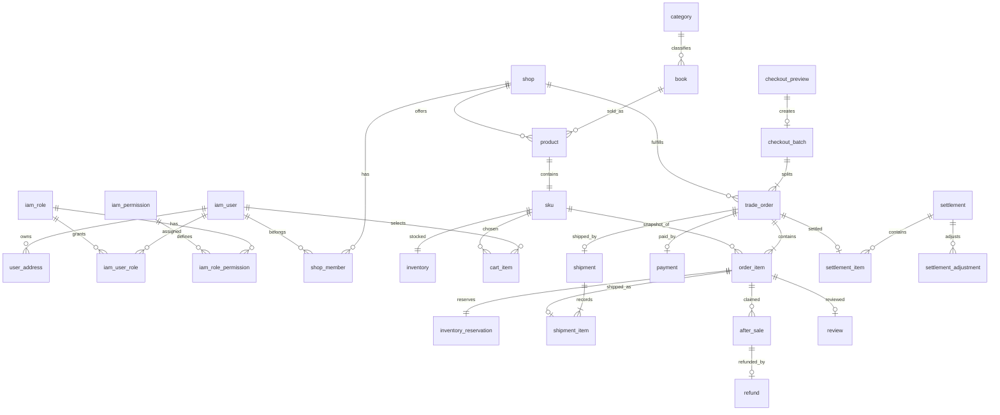

# 阅集图书商城数据库设计

阶段 D 实施注记（2026-10-24）：V7 在原结构上新增 inventory_reservation、order_status_log、outbox_event、job_lease 四表，总计 30 表；V1—V6 保持不变。预览、批次、订单与行开始由真实接口写入；售后、评价结构仍无开发写入。状态日志由触发器禁止更新/删除。

版本：1.0｜用途：逻辑与物理结构设计，不包含可执行 DDL。

## 1 通用约定

数据库采用 MySQL 8.4、InnoDB、utf8mb4；数据库名设计为 yueji_mall。标识符采用小写下划线，避免 user、order 等关键字。主键 id 为 BIGINT UNSIGNED 自增，接口一律转字符串，业务单号与主键分离且不可复用。

所有表默认包含 id、created_at、updated_at：id 非空主键；时间为 DATETIME(3)、UTC、非空。创建时写入当前 UTC，更新时仅改变 updated_at；流水表禁止业务更新。下表未出现公共字段时仍继承该约定。

记号：`?` 表示允许空，其余非空；`=值` 为默认值；无默认值的非空字段创建时必须提供。FK 表示物理外键（删除 RESTRICT），索引未注明时为普通 B-tree。外键不能替代权限校验。关系历史采用快照保存，不因用户或商品修改而重写。

| 类型记号 | 物理类型与含义 |
|---|---|
| ID | BIGINT UNSIGNED，外键同类型 |
| CODE(n)、TEXT(n) | VARCHAR(n)，CODE 区分大小写以适配业务键，TEXT 使用文本排序规则 |
| MONEY | DECIMAL(12,2)，非负；调整金额单独允许负值 |
| QTY | INT UNSIGNED，业务操作数量 1—99，库存累计可更大 |
| TIME | DATETIME(3)，UTC |
| BOOL | TINYINT，取值 0/1 |
| ENUM(n) | VARCHAR(n)，应用及数据库检查约束限定枚举，枚举定义见 02 |
| JSON | MySQL JSON，只用于快照、事件、有限审计摘要，不代替可查询关联字段 |

订单金额、库存、退款累计、星级等通过数据库检查与应用校验共同保障。禁止全表统一软删除：用户和商品用状态停用，财务流水只追加，购物车和过期会话可以物理清理。

补充状态域：category、book、iam_role、shop_member 使用 ACTIVE / DISABLED；file_object 使用 ACTIVE / DELETED。shop 单独使用 ACTIVE / SUSPENDED，地址使用 ACTIVE / DELETED，Product 使用 DRAFT / ON_SALE / OFF_SHELF；各状态不可混用。禁用分类或书目阻止新的公开销售，不影响历史订单履行。

## 2 ER 关系

图展示主干关系；会话、日志、幂等和消息等支撑表在下文定义。checkout_preview 与批次为一对零或一；Product 与 SKU 首版一对一，扩展多规格时须变更唯一约束及接口。

## 3 身份和店铺

### 3.1 iam_user

| 字段 | 类型与默认 | 含义 |
|---|---|---|
| username | CODE(32) | 登录名，小写字母数字及下划线，注册时规范化 |
| password_hash | CODE(100) | BCrypt 哈希 |
| nickname | TEXT(40) | 展示名称 |
| status | ENUM(16)=ACTIVE | ACTIVE / DISABLED |
| auth_version | INT UNSIGNED=1 | 密码、禁用、授权变更时递增 |
| failed_login_count | INT UNSIGNED=0 | 连续失败计数 |
| locked_until | TIME? | 临时登录锁定截止 |
| last_login_at | TIME? | 最后成功登录 |

约束：username 唯一；status、created_at 联合索引。账号不删除，日志和历史订单保留引用。

### 3.2 授权关系表

| 表 | 专有字段 | 约束 |
|---|---|---|
| iam_role | code CODE(32)、name TEXT(50)、status ENUM(16)=ACTIVE | code 唯一；内置角色代码固定见 04 |
| iam_permission | code CODE(80)、name TEXT(80) | code 唯一，映射后端动作权限 |
| iam_user_role | user_id ID FK、role_id ID FK | user_id＋role_id 唯一 |
| iam_role_permission | role_id ID FK、permission_id ID FK | role_id＋permission_id 唯一 |
| shop | name TEXT(80)、status ENUM(16)=ACTIVE、contact_name TEXT(40)、contact_phone TEXT(32) | ACTIVE / SUSPENDED；name 普通索引；创建不隐式授予成员权限 |
| shop_member | shop_id ID FK、user_id ID FK、duty ENUM(16)、status ENUM(16)=ACTIVE | duty 为 MERCHANT / WAREHOUSE；shop＋user＋duty 唯一；user＋status 索引 |
| refresh_session | user_id ID FK、family_no CODE(64)、token_hash CODE(64)、expires_at TIME、revoked_at TIME?、replaced_by_id ID? FK、csrf_hash CODE(64)、auth_version INT UNSIGNED | token_hash 唯一；family_no 索引；user＋expires_at 索引；明文令牌不落库 |

refresh_session 的每次轮换保留旧记录用于重放检测，过期 30 天清理。shop_member 中的 duty 和 iam_role 都必须满足对应操作的权限规则，不能只凭其中之一访问店铺。

阶段 B 实施注记（2026-10-23）：V1—V4 已实现本节身份、店铺、地址及 audit_log 共 10 表；其余业务表仍为设计。有效默认地址生成列物理名为 default_user_id，仅用于既定唯一约束，不进入 API；audit_log 的防更新/删除由触发器补强。开发与测试使用独立库名，字段、ID/时间类型、状态及 FK RESTRICT 规则保持本设计。迁移版本与真实验证见 stages/B-验证与交接.md。

### 3.3 user_address

字段：user_id ID FK、receiver_name TEXT(40)、phone TEXT(32)、province TEXT(40)、city TEXT(40)、district TEXT(40)、detail TEXT(200)、is_default BOOL=0、status ENUM(16)=ACTIVE。状态 ACTIVE / DELETED。

索引：user_id＋status；每用户一个有效默认地址，设计使用“有效默认 user_id”生成值唯一约束（非默认为 NULL）并在用户锁内切换。删除地址为软删除，不修改订单地址快照。手机号在日志和非履约页面脱敏。

## 4 图书、商品与文件

| 表 | 字段设计 | 约束与索引 |
|---|---|---|
| category | parent_id ID? FK、name TEXT(50)、sort_order INT=0、status ENUM(16)=ACTIVE | 首版两级，禁止循环；parent＋sort 索引；停用前检查有效书目 |
| book | isbn CODE(13)、title TEXT(200)、author TEXT(200)、publisher TEXT(120)、publication_date DATE?、category_id ID FK、description TEXT(5000)、cover_file_id ID? FK、status ENUM(16)=ACTIVE | ISBN-13 去连字符并校验；isbn 唯一；category＋status＋id 索引；首版书名作者小规模模糊检索 |
| product | shop_id ID FK、book_id ID FK、description TEXT(5000)、status ENUM(16)=DRAFT、featured BOOL=0、version INT UNSIGNED=1 | shop＋book 唯一；DRAFT / ON_SALE / OFF_SHELF；shop＋status、status＋featured 索引 |
| sku | product_id ID FK、sku_code CODE(64)、sale_price MONEY、version INT UNSIGNED=1 | product 唯一，sku_code 唯一，价格>0；变价递增 version |
| file_object | owner_user_id ID FK、shop_id ID? FK、purpose ENUM(24)、visibility ENUM(16)、storage_key CODE(255)、mime_type CODE(40)、byte_size BIGINT UNSIGNED、sha256 CODE(64)、status ENUM(16)=ACTIVE | purpose BOOK_COVER / AFTER_SALE_EVIDENCE；visibility PUBLIC / PRIVATE；storage_key 唯一；owner＋created 索引 |

分类/图书停用、商品下架均不级联删除历史引用。运营可编辑公共书目和封面，商家不能更改 ISBN 或全平台基础资料；同店同书重新销售复用已下架 Product。商品状态、介绍、精选等变更递增 product.version；价格修改在同一事务递增 product.version 和 sku.version。公开查询及下单都验证图书/分类有效，不能因 Product 仍是 ON_SALE 而出售已停用书目。

售后凭证为独立关联表 after_sale_evidence：after_sale_id ID FK、file_id ID FK；组合唯一；同一凭证不可跨用户引用。最多五张由服务和事务验证。

封面使用受限元数据关联；临时已上传未引用文件 24 小时后可清理，已引用凭证保留。回收任务必须先确认所有引用，不按“上传日期旧”直接删除。

## 5 购物车与库存

| 表 | 字段设计 | 约束与索引 |
|---|---|---|
| cart_item | user_id ID FK、sku_id ID FK、quantity QTY、selected BOOL=1 | user＋sku 唯一；quantity 1—99 |
| inventory | sku_id ID FK、on_hand QTY=0、reserved QTY=0、version INT UNSIGNED=1 | sku 唯一；0≤reserved≤on_hand；available=on_hand−reserved 为查询派生值不单独维护 |
| inventory_reservation | order_id ID FK、order_item_id ID FK、sku_id ID FK、quantity QTY、status ENUM(16)=RESERVED、expires_at TIME | order_item 唯一；order＋status、status＋expires 索引；quantity>0 |
| inventory_movement | sku_id ID FK、order_item_id ID? FK、after_sale_id ID? FK、movement_type ENUM(32)、business_key CODE(100)、on_hand_delta INT、reserved_delta INT、on_hand_after QTY、reserved_after QTY、reason TEXT(300)、operator_id ID? FK、trace_id CODE(64) | business_key 唯一；sku＋created 索引；只追加 |

movement_type：MANUAL_ADJUST、RESERVE、COMMIT、RELEASE、REFUND_RESTOCK、RETURN_RESTOCK。库存调整必须给原因；人工调整仅改变 on_hand，不允许改变 reserved；条件不满足拒绝整个操作。每种业务动作派生稳定 business_key，用于防止退款回补或退货回补重复执行。

## 6 预览与订单

### 6.1 checkout_preview 和 checkout_batch

| 表 | 字段设计 | 约束 |
|---|---|---|
| checkout_preview | user_id ID FK、address_id ID FK、items_snapshot JSON、address_version_hash CODE(64)、amount MONEY、expires_at TIME、used_at TIME? | user＋expires 索引；items_snapshot 保存 cartItemId、cartUpdatedAt、skuId、quantity、skuVersion、productVersion、price、shopId；用于提交核对 |
| checkout_batch | batch_no CODE(40)、user_id ID FK、preview_id ID FK、total_amount MONEY | batch_no 唯一、preview 唯一；user＋created 索引 |

预览不能作为永久价格凭证，订单快照才是历史事实。预览过期且未产生批次的记录在 7 天后清理；已产生批次的关联记录保留，不能违反外键。

### 6.2 trade_order

| 字段 | 类型与默认 | 含义 |
|---|---|---|
| order_no | CODE(40) | 唯一业务单号 |
| batch_id | ID FK | 所属跨店提交 |
| user_id / shop_id | ID FK | 会员与店铺 |
| status | ENUM(24)=PENDING_PAYMENT | 订单状态，见 02 |
| financial_status | ENUM(24)=UNPAID | 独立财务状态 |
| goods_amount / freight_amount / payable_amount | MONEY；freight_amount=0.00 | 商品金额、运费及应付快照 |
| refunded_amount | MONEY=0.00 | 已成功退款累计，不含处理中 |
| receiver_name / receiver_phone | TEXT(40) / TEXT(32) | 下单时快照 |
| receiver_address | TEXT(300) | 省市区与详情快照 |
| expires_at | TIME | 支付截止时间 |
| paid_at / shipped_at / completed_at / closed_at | TIME? | 对应状态发生时间 |
| close_reason | TEXT(300)? | 用户取消、超时或全额退款 |
| version | INT UNSIGNED=1 | 并发修改版本 |

约束：order_no 唯一，batch＋shop 唯一；payable=goods＋freight，refunded≤payable；索引 user＋created＋id、shop＋status＋created、status＋expires、completed_at。状态查询必须包含合法用户/店铺范围，不能先分页再过滤权限。

### 6.3 order_item 和 order_status_log

| 表 | 字段设计 | 约束 |
|---|---|---|
| order_item | order_id ID FK、sku_id ID FK、book_id ID FK、product_id ID FK、book_title TEXT(200)、isbn CODE(13)、cover_storage_key CODE(255)?、sku_code CODE(64)、unit_price MONEY、quantity QTY、line_amount MONEY、refunded_quantity QTY=0、refunded_amount MONEY=0.00 | order＋sku 唯一；行金额=单价×数量；退款数量≤数量，退款金额≤行金额；快照字段不可随商品更新 |
| order_status_log | order_id ID FK、from_status ENUM(24)?、to_status ENUM(24)、action CODE(50)、operator_id ID? FK、reason TEXT(300)、trace_id CODE(64) | order＋created＋id 索引；只追加；from_status 首次创建可空 |

售后处理中数量从进行中 after_sale 聚合并在订单行锁内校验，不另存易失配的重复字段。可发货数量为购买数量减成功退款数量；存在进行中售后时整单暂停发货。

## 7 支付、退款与对账

| 表 | 字段设计 | 约束与索引 |
|---|---|---|
| payment | payment_no CODE(40)、order_id ID FK、provider ENUM(24)、status ENUM(16)=INIT、amount MONEY、currency CODE(3)=CNY、channel_trade_no CODE(80)?、paid_at TIME?、last_checked_at TIME?、failure_code CODE(80)? | payment_no 唯一、order 唯一、provider＋channel_trade_no 唯一；provider ALIPAY_SANDBOX / LOCAL_MOCK；status＋updated 索引 |
| payment_event | payment_id ID? FK、provider ENUM(24)、event_key CODE(128)、channel_trade_no CODE(80)?、event_type CODE(40)、verified BOOL、payload_digest CODE(64)、processed_at TIME?、processing_status ENUM(16)=RECEIVED、trace_id CODE(64) | provider＋event_key 唯一；仅保存必要摘要，私钥及签名正文不入日志；未知单号允许 payment_id 空并转差异 |
| refund | refund_no CODE(40)、payment_id ID FK、after_sale_id ID? FK、reason_type ENUM(32)、status ENUM(16)=CREATED、amount MONEY、channel_refund_no CODE(80)?、requested_by ID? FK、succeeded_at TIME?、failure_code CODE(80)? | refund_no 唯一、after_sale 唯一；status＋updated 索引；NORMAL_AFTER_SALE / LATE_PAYMENT_COMPENSATION |
| reconciliation_run | provider ENUM(24)、bill_date DATE、status ENUM(16)=PENDING、checked_count INT UNSIGNED=0、difference_count INT UNSIGNED=0、completed_at TIME?、evidence_file_key CODE(255)? | provider＋bill_date 唯一；PENDING / RUNNING / SUCCEEDED / FAILED |
| reconciliation_issue | run_id ID? FK、order_id ID? FK、payment_id ID? FK、refund_id ID? FK、issue_key CODE(128)、issue_type CODE(40)、expected_amount MONEY?、actual_amount MONEY?、status ENUM(16)=OPEN、resolution TEXT(1000)?、resolved_by ID? FK、resolved_at TIME? | issue_key 唯一；status＋created 索引；OPEN / RESOLVED；查单即时差异可无 run_id |

正常退款必须有 after_sale_id；迟到支付补偿退款无售后，以 paymentId＋reason_type 唯一业务约束保障只创建一次。退款总额校验锁 payment，并累计成功及处理中退款，禁止超退；正常申请还校验订单行数量。原支付渠道一旦发起不得改成另一渠道。

payment_event.processing_status 为 RECEIVED / PROCESSED / REJECTED；验签失败不得触发交易状态变化。事件去重与 payment 的状态幂等同时存在，不能只依赖渠道通知 ID。

## 8 履约、售后与评价

| 表 | 字段设计 | 约束与索引 |
|---|---|---|
| shipment | order_id ID FK、carrier TEXT(50)、tracking_no CODE(80)、shipped_by ID FK、shipped_at TIME、received_at TIME? | order 唯一；carrier＋tracking 普通索引；发货数量由订单剩余量确定 |
| shipment_item | shipment_id ID FK、order_item_id ID FK、shipped_quantity QTY | order_item 唯一；数量>0；发货时保存剩余数量快照，后续退款不重写历史发货量 |
| shipment_event | shipment_id ID FK、event_time TIME、description TEXT(300)、source ENUM(16)=MANUAL、operator_id ID FK | shipment＋event_time 索引；MANUAL / SYSTEM；展示需标注“人工录入” |
| after_sale | after_sale_no CODE(40)、order_id ID FK、order_item_id ID FK、user_id ID FK、type ENUM(24)、quantity QTY、requested_amount MONEY、reason TEXT(500)、status ENUM(24)=REQUESTED、reviewed_by ID? FK、reviewed_at TIME?、review_note TEXT(500)?、return_deadline TIME?、return_carrier TEXT(50)?、return_tracking_no CODE(80)?、received_by ID? FK、received_at TIME?、restock_quantity QTY=0、inspection_note TEXT(500)? | 单号唯一；order_item＋status 索引；使用进行中订单行生成值唯一约束保证同一行最多一个活跃申请；type REFUND_ONLY / RETURN_REFUND |
| review | order_item_id ID FK、user_id ID FK、product_id ID FK、rating TINYINT UNSIGNED、content TEXT(1000)、status ENUM(16)=VISIBLE、moderated_by ID? FK、moderation_reason TEXT(300)? | order_item 唯一；rating 1—5；product＋status＋created 索引；VISIBLE / HIDDEN |

退货验收的 restock_quantity 只能是 0 或申请 quantity，首版不支持一张售后部分验收。验收更新与库存流水同一事务。after_sale 金额固定来自快照，后台没有任意金额编辑入口。

## 9 结算

| 表 | 字段设计 | 约束与索引 |
|---|---|---|
| settlement | settlement_no CODE(40)、shop_id ID FK、period_date DATE、status ENUM(16)=DRAFT、gross_amount MONEY=0.00、refund_amount MONEY=0.00、fee_amount MONEY=0.00、adjustment_amount DECIMAL(12,2)=0.00、payable_amount DECIMAL(12,2)=0.00、created_by ID FK、approved_by ID? FK、approved_at TIME?、paid_by ID? FK、paid_at TIME?、mock_payout_no CODE(80)?、version INT UNSIGNED=1 | 单号唯一、shop＋period_date 唯一、模拟出款号唯一；shop＋status 索引；approve 人不能是 created_by |
| settlement_item | settlement_id ID FK、order_id ID FK、goods_amount MONEY、refund_amount MONEY、net_amount MONEY、fee_rate DECIMAL(6,4)=0.0300、fee_amount MONEY、payable_amount MONEY | order 唯一；settlement 索引；历史快照不可随订单变化重算；拒绝或回退时可删除未出款明细释放占用 |
| settlement_adjustment | shop_id ID FK、original_settlement_id ID FK、order_id ID FK、issue_id ID FK、target_settlement_id ID? FK、amount DECIMAL(12,2)、reason TEXT(500)、created_by ID FK、approved_by ID? FK、status ENUM(16)=PENDING | issue 唯一；shop＋status 索引；PENDING / APPROVED / APPLIED；amount 允许负；出款前必须复核 |

gross_amount 为所含订单商品原实付合计；refund_amount 为成功退款合计；fee_amount 为逐订单计算后累加；payable= gross−refund−fee＋adjustment。跨账期负余额作为已审核调整转入下一账期，不虚构负数出款。

## 10 审计、幂等和异步支撑

| 表 | 字段设计 | 约束与索引 |
|---|---|---|
| audit_log | actor_id ID? FK、action CODE(80)、resource_type CODE(40)、resource_id CODE(64)?、shop_id ID? FK、result ENUM(16)、summary JSON、trace_id CODE(64)、ip_hash CODE(64)? | actor＋created、shop＋created、trace 索引；SUCCESS / DENIED / FAILED；只追加 |
| idempotency_record | user_id ID FK、operation_id CODE(40)、idempotency_key CODE(64)、request_hash CODE(64)、status ENUM(16)=PROCESSING、resource_type CODE(40)?、resource_id CODE(64)?、response_snapshot JSON?、replay_until TIME、retain_until TIME | user＋operation＋key 唯一；retain_until 索引；PROCESSING / SUCCEEDED；业务失败回滚不留成功结果 |
| outbox_event | event_id CODE(64)、event_type CODE(80)、schema_version INT UNSIGNED=1、aggregate_type CODE(40)、aggregate_id CODE(64)、payload JSON、trace_id CODE(64)、status ENUM(16)=PENDING、attempts INT UNSIGNED=0、next_attempt_at TIME、published_at TIME?、lease_owner CODE(80)?、lease_until TIME? | event_id 唯一；status＋next_attempt 索引；PENDING / PUBLISHED / FAILED |
| consumed_event | consumer_name CODE(80)、event_id CODE(64)、processed_at TIME | consumer＋event 唯一；只记录成功消费 |
| job_lease | job_name CODE(80)、owner CODE(80)、lease_until TIME、version INT UNSIGNED=1 | job_name 唯一，用于定时任务多实例防重入 |

Outbox 消息包含 eventId、eventType、schemaVersion、occurredAt、aggregateId、traceId、data；不包含令牌、详细地址和支付密钥。消费者不依赖事件有序到达，处理前核对数据库当前状态。

## 11 索引、迁移和数据生命周期

查询设计先限定 user_id/shop_id 再按状态和时间分页，分页默认 20、最大 100；按 created_at 与 id 双字段稳定排序。索引不盲目覆盖所有字段，实施阶段提供主要查询执行计划，特别关注订单列表、待关单、待发布 Outbox、待退款和结算候选查询。首版模糊搜索不宣称可在任意规模下高性能，性能不达标先优化查询和业务索引，再通过 ADR 评估搜索引擎。

迁移阶段：身份与店铺 → 文件分类图书商品 → 库存购物车地址 → 预览订单 → 支付退款履约售后 → 评价结算 → 审计消息与运行索引。实际外键依赖必须拓扑排序，例如售后主表建立后再添加退款外键，不能机械照章节次序执行。

已发布迁移不改写；新增结构优先允许旧版应用运行，再回填验证和收紧约束。演示种子与生产迁移分开，生产不自动生成固定管理员密码。不把 AI 使用日志建成商城业务表。

设计保留期：订单和财务记录在实验期内不删除；审计至少 180 天；运行日志 14 天；已发送 Outbox 和成功消费记录至少 30 天且不得早于允许的人工重放窗口；售后凭证至少覆盖售后及结算争议期，实验期不自动删除。实际商业上线需重新确认数据保留政策。

## 12 种子数据设计

至少 3 家店铺、20 本书、30 个店铺 SKU，包含同 ISBN 多店报价、缺货、下架和最后 10 本库存场景；10 个分类节点（最多两级）；两个普通会员、每店商家和仓库、运营、客服、管理员及两个财务账号。明确每个账号权限，不将管理员兼任全部角色。

订单样本覆盖待支付、关闭处理中、已支付、已发货、已完成、取消、全额退款；售后覆盖退款、退货、失败重试；结算覆盖可结算、售后冻结、对账异常和已模拟出款。所有样本使用虚构个人信息；登录口令实施时本地生成并单独交付，不写入本设计。
