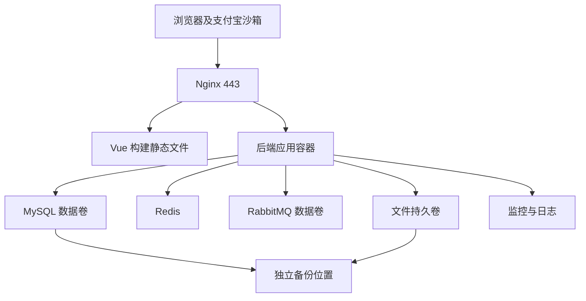

# 阅集图书商城开发环境与部署设计

版本：1.0｜本文件定义环境准备与运行流程，不提供安装命令、配置文件或脚本。

## 1 运行基线与资源预算

开发主机为 Windows 10/11，推荐 16GB 内存、40GB 可用磁盘，启用 CPU 虚拟化、WSL2 和 Docker Desktop Linux 容器。Java/前端可在 Windows IDE 运行，MySQL、Redis、RabbitMQ 由容器提供；统一把仓库放在一种文件系统中，避免 Windows 与 WSL 同时操作同一依赖目录。

部署目标为 Ubuntu 24.04 LTS 单台 Linux，基础应用推荐 4 vCPU/8GB、80GB SSD；若同时运行 Grafana、Prometheus 和 Loki，推荐 16GB。性能验收使用 01 的固定环境，压测进程不与应用争抢资源。单机故障存在停机风险，项目不宣称多可用区高可用。

| 类别 | 设计版本线 | 配套要求及选择原因 |
|---|---|---|
| Java | JDK 21 LTS | 后端统一编译和运行版本；Spring Boot 3.5 官方要求允许该版本 |
| 后端 | Spring Boot 3.5、Spring Security 随 Boot BOM | 模块化单体与成熟事务生态；不引入 Spring Cloud |
| 构建与 ORM | Maven 3.9、MyBatis-Plus 3.5、Flyway 与 Boot 兼容线 | Wrapper 锁定；MySQL 方言模块兼容性纳入首轮验证 |
| 前端 | Vue 3、TypeScript、Vite、Vue Router 4、Pinia、Element Plus | 同一 Vue 工程，选定依赖组合后生成锁文件 |
| Node 与包管理 | Node 24 LTS、pnpm 10 | 不沿用旧草稿 Node 20；按当前官方发布周期选受维护 LTS |
| 数据库 | MySQL 8.4 LTS | InnoDB、utf8mb4，持久化数据卷 |
| 缓存与消息 | Redis 7.4、RabbitMQ 4.1 | 缓存与限流、确认投递和死信；镜像补丁及许可由版本冻结清单确认 |
| 网关与容器 | Nginx 稳定线、Docker Engine、Compose v2 | TLS、静态资源、单机部署 |
| 可观测性 | Prometheus 3、Grafana、Loki | 指标、看板与日志；组件补丁兼容组合实施前锁定 |
| 测试 | JUnit 5、Testcontainers、Vitest、Playwright、k6、JaCoCo | 后端/基础设施/浏览器/性能分别验证 |
| 交付 | GitHub Actions、GHCR、SSH | 自动质量检查、不可变镜像和受控单机发布 |

这些是设计兼容线，不等同于“截至当天全部为最新版本”。实施阶段在项目初始化前核对官方支持周期、漏洞公告与互相兼容性，冻结精确补丁号、镜像 digest、校验日期及来源；不得使用 latest。若某线已不适合使用，须记录 ADR 并同步文档，不静默升级大版本。

官方参考：Spring Boot Java 兼容性见 https://docs.spring.io/spring-boot/3.5/system-requirements.html；Node 周期见 https://github.com/nodejs/Release；支付宝环境准备见 https://open.alipay.com/paymentServicer/paymentProvider.htm。链接为选型依据，不替代实际账号联调。

## 2 准备顺序与通过标志

| 阶段 | 要准备的事项 | 完成标志与证据 |
|---|---|---|
| 主机 | 虚拟化、WSL2、Docker、磁盘目录和时钟同步 | Linux 容器可运行，版本信息截图，磁盘满足预算 |
| 工具 | Git、JDK、Maven Wrapper、Node、pnpm、IDE | 版本记录一致，前后端依赖锁文件可复现安装 |
| 数据服务 | 独立数据库账号、字符集、时区、数据卷；Redis 和 RabbitMQ 账号 | 应用账号只能访问指定库；容器健康；重启数据保留 |
| 工程 | backend/frontend/infra/docs 目录、统一接口和异常骨架 | 后端健康接口和前端空路由可启动；不是完成业务功能 |
| 数据初始化 | Flyway 迁移、dev/test 专用种子、演示账号 | 空库迁移成功，再启动不重复造数据；账号权限符合矩阵 |
| 本地联调 | 前端开发代理到后端，Cookie、Origin 和 CSRF 配置 | 登录刷新退出可验证，单一路径 `/api/v1` 无重复前缀 |
| 支付 | 沙箱应用、沙箱买卖方、私钥和支付宝公钥、网关、回调 | 支付及查单最小联调通过，截图不含私钥；本地模拟单独开关 |
| Linux 部署 | 域名或可访问主机、TLS、Docker、SSH 部署账号、镜像拉取授权 | 主机能拉取指定 SHA 镜像，回调可达，外网无法直连数据服务 |
| 运维 | 监控看板、日志卷、备份位置、告警接收环境 | 人工故障能触发测试告警，备份可在隔离库恢复 |

首次用沙箱前确认该账号实际支持所选电脑网站支付、查询、关闭、退款和账单能力。沙箱有能力限制时，文档与验收明确标记实际验证范围；不能把本地模拟截图当支付宝沙箱证据。

## 3 端口与访问设计

| 服务 | 本机开发入口 | 部署入口 |
|---|---|---|
| 前端 | 5173 | Nginx 443，80 仅跳转 TLS |
| 后端 | 8080，仅本机或开发网 | 仅容器内部，不直接公开 |
| MySQL | 3306 绑定回环地址 | 内部网络 |
| Redis | 6379 绑定回环地址 | 内部网络 |
| RabbitMQ | 5672，管理 15672 仅本机 | 内部网络，控制台通过运维通道 |
| Grafana / Prometheus / Loki | 3000 / 9090 / 3100，仅本机 | 运维网络或 SSH 隧道；Grafana 需认证 |

开发浏览器访问前端代理，避免随意放宽 CORS。部署中前端和 API 同域，`/api/v1` 反代后端。支付宝回调映射到 API-35；沙箱需要公网可达回调时用测试域名，临时隧道地址不得作为稳定生产配置。回跳到前端支付结果页只用于导航，必须查询后台结果。

## 4 配置项字典

后续实现生成只含名称、说明和占位符的环境样例文件，真实值由开发环境或 CI secrets 注入。

| 配置名 | 内容 | 敏感/范围 |
|---|---|---|
| APP_ENV、APP_BASE_URL | dev/test/prod，外部访问根地址 | 普通；全部环境 |
| DB_HOST、DB_PORT、DB_NAME、DB_USERNAME、DB_PASSWORD | 数据库连接 | 口令敏感；独立账号 |
| REDIS_HOST、REDIS_PORT、REDIS_PASSWORD | 缓存连接 | 口令敏感 |
| MQ_HOST、MQ_PORT、MQ_USERNAME、MQ_PASSWORD、MQ_VHOST | 消息服务 | 口令敏感；环境隔离 |
| JWT_SIGNING_KEY、JWT_ISSUER | 签名及签发方 | 私钥或密钥敏感；不写前端 |
| ALLOWED_ORIGINS、COOKIE_SECURE | 允许源及 TLS Cookie 策略 | dev 可仅 localhost 非 TLS，其余 Secure |
| PAYMENT_PROVIDER、ENABLE_MOCK_PAYMENT | ALIPAY_SANDBOX/LOCAL_MOCK 与模拟开关 | prod 禁止 LOCAL_MOCK 与确认路由；本项目沙箱可在 prod 配置的演示实例运行 |
| ALIPAY_APP_ID、ALIPAY_GATEWAY | 沙箱应用与网关 | 网关必须对应沙箱，禁止错误连真实交易环境 |
| ALIPAY_APP_PRIVATE_KEY、ALIPAY_PUBLIC_KEY | 应用私钥与验签公钥 | 私钥敏感，通过受限文件或密钥挂载 |
| ALIPAY_NOTIFY_URL、ALIPAY_RETURN_URL | 后台通知与前端返回 | 绝对地址；通知必须外部可达 |
| FILE_STORAGE_ROOT、PUBLIC_FILE_BASE_URL | 文件卷与公开封面根地址 | 不能把私有售后目录公开 |
| LOG_LEVEL、METRICS_ENABLED | 日志与指标 | 生产不得记录 DEBUG 敏感详情 |
| IMAGE_TAG、DEPLOY_ENV、BACKUP_LOCATION | 发布版本、部署环境、备份目标 | 拉取凭据和备份凭据另行注入 |

结算一直是模拟出款，不随 PAYMENT_PROVIDER 切换为真实转账。环境命名 prod 表示部署配置隔离和安全强度，不表示已经接入真实金融交易。

## 5 本地启动与联调流程设计

后续 README 必须给出对应 Windows PowerShell 与 Linux 命令；本文件只固定顺序和通过标准：准备依赖与配置 → 启动数据容器并等待就绪 → 数据库迁移 → 显式选择开发种子 → 后端启动 → 前端启动 → 身份接口冒烟 → 商品和订单联调 → 打开监控。

先完成 LOCAL_MOCK 下的正常、重复回调和异常测试，再切换独立的 ALIPAY_SANDBOX 测试环境。已有订单的 provider 不随全局配置修改，切换渠道不得复用旧付款单。开发和测试使用独立库、队列 vhost、Redis 前缀与文件目录。

初始化账号使用随机演示口令或开发者自行设定；截图中展示角色与用户名即可。默认密码不得进源码和生产样例。重置种子只能作用于明确的 dev/test 数据库，任何脚本应显示目标环境并有破坏性操作保护。

## 6 部署拓扑和生命周期

Linux 部署目录规划 /opt/yueji，配置与数据卷不进入镜像；发布目录保存本次镜像 digest 和上次版本。账号权限最小化，不使用默认数据库 root 运行应用。应用监听仅容器内网，主机防火墙对外仅开放必要的 HTTPS 与受限 SSH。

上线前记录迁移版本、备份标识和镜像清单；先完成兼容迁移，再启动应用和静态资源，健康和冒烟通过后结束维护窗口。停止服务前停止受理新交易并等待已受理事务收敛；不得直接删除数据卷。发布回滚和恢复流程详见 08。

## 7 常见问题诊断设计

连接失败按网络、端口、凭据、健康状态顺序定位；迁移失败保留错误与原库，不能自动清库；支付通知未到按公网回调、签名配置、渠道记录及主动查单排查；刷新循环按 Cookie 域、Secure、Origin 和 CSRF 检查；图片缺失核对元数据、卷挂载与可见性，不临时公开整个存储目录。

环境截图和版本冻结表使用 13 的模板。尚未实际运行的检查保持“待执行”，不能用本设计的步骤推断“环境已搭建完成”。
