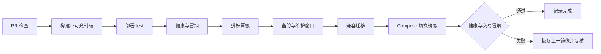

# 阅集图书商城 CI CD 与运维设计

版本：1.0｜范围：流水线、发布和运维策略，不提供工作流 YAML 或脚本。

## 1 源码和环境管理

单仓库管理 backend、frontend、infra、docs。采用 main 受保护主干，feature/* 与 fix/* 短分支，PR 合入，不额外长期维护 develop。提交说明使用清楚的变更类型和目的；PR 关联需求编号、接口/数据库变更、测试证据、回滚影响和 AI 留痕。

环境 dev/test/prod 的数据库、Redis 前缀、MQ vhost、账号、文件路径和密钥独立；只有明确授权的演示测试数据可进入发布环境。prod 仍仅接支付宝沙箱和模拟商家出款，不扩展到真实金融业务。

## 2 流水线阶段

| 触发 | 阶段 | 输入与输出 | 阻断条件 |
|---|---|---|---|
| 每次 PR | 文档/格式/静态/类型检查 | 文档链接、契约、Java/TS 静态报告 | 接口契约缺失、类型错误、格式不符 |
| 每次 PR | 单元与集成 | JUnit/Vitest、Testcontainers、覆盖率 | 测试失败、核心分支覆盖<80% |
| 每次 PR | 安全检查 | 依赖漏洞、SAST、密钥扫描 | 新增未处理高危或真实凭据泄露 |
| 每次 PR | 契约及最小 E2E | API 操作覆盖表、登录购买流程报告 | 契约漂移、关键流程失败 |
| 合入 main | 构建并发布候选镜像 | 后端/前端 OCI 镜像、SHA 标签、digest、SBOM | 构建或镜像扫描失败，不上传可晋级制品 |
| 候选制品成功 | 部署 test | SSH 发布同一 digest、兼容迁移、健康与冒烟报告 | 迁移失败、未就绪、交易或授权冒烟失败 |
| 人工选择候选版本 | 晋级演示 prod | 记录批准人、备份和维护窗口，复用 test 镜像 | 无 test 通过证据、缺备份、危险迁移 |
| 每夜/发布前 | 全量 E2E、性能和恢复演练 | 原始报告、趋势、异常清单 | 核心一致性或安全失败阻断下一次晋级 |

普通 PR 不部署服务器；来自外部分叉的 PR 不可访问 secrets，不运行不受信任代码的高权限工作流。文档变更可仅运行文档/契约检查，但接口、数据库及环境设计变更必须人工评估相关测试范围，不能按路径一律跳过。

流水线使用最小权限令牌，发布 GHCR 和 SSH 权限只在对应 job 提供；第三方 Actions 固定完整提交 SHA，并记录其版本来源。构建中的应用密钥不写入镜像层。依赖缓存按锁文件和工具链版本分区，不能用缓存绕过依赖安装验证。

## 3 发布制品和晋级

每次发布清单包含：Git SHA、后端和前端镜像 digest、数据库迁移版本、配置版本、契约版本、测试链接、漏洞例外、构建时间及批准人。禁止只用 latest 标识；test 和 prod 晋级同一 digest，不在生产主机临时重新编译。

私有仓库计划或账号可能不支持环境必需审核时，退化为有权限维护者手动触发 CD 并在发布记录中签署批准，不能声称已配置无法使用的自动审批门禁。SSH 主机指纹预先可信登记，专用部署账号只能执行项目部署所需操作；不能为了连接方便关闭主机校验。

## 4 单机发布设计

发布按环境获取互斥锁，禁止两次发布同时执行。进入维护窗口后暂停创建新订单及后台高风险写，允许查询和必要渠道回调；应用更换阶段可能暂时不可用，依赖渠道重试和主动查单恢复。先等待在途本地事务结束，再优雅停止；不依赖“浏览器禁用按钮”阻止写入。

发布前完成数据库及文件备份并记录标识，预拉取镜像，检查磁盘和依赖健康；执行向前兼容迁移；切换应用与静态资源；最多等待 120 秒就绪，再执行最小冒烟：登录、查询商品、创建测试订单、取消并核实库存、权限拒绝。外部沙箱完整支付在 test 验证，prod 发布冒烟不制造真实资金操作。

成功后解除维护、记录版本并检查队列积压和错误率。失败停止晋级，保留失败实例日志，再恢复上一 digest。单机 Compose 采用明确维护窗口，不承诺滚动发布或零停机。

## 5 数据库回滚与恢复

应用回滚与数据库恢复分开。常规迁移采用扩展 → 回填 → 验证 → 收紧，旧应用必须能在新结构上暂时运行，禁止同次发布直接删除旧字段或改变既有字段语义。迁移失败时不启动不兼容新应用，先判断旧应用可否继续服务；不自动执行逆向删表。

若有不可逆数据破坏，进入人工恢复流程：停写、保存事故后的库和日志、确定恢复点、在隔离库恢复验证、核对支付退款渠道事实、补偿差异，再切回服务。恢复备份可能丢失其后的本地订单记录，必须用渠道记录对账，不能简单回滚后宣布完成。

备份每日一次，保留至少 7 个日备份与 4 个周备份；异地主机或独立对象存储保存加密副本，备份凭据单独管理。文件卷与数据库记录按同一备份批次关联；备份期间暂停上传和文件清理，数据库采用一致性快照，保留快照前已引用文件的完整集合。每周在隔离环境实际恢复一次，记录 RPO/RTO、表计数、订单抽样及文件可读性。目标见 NFR-04。

## 6 监控指标与告警

| 类别 | 指标 | 起始告警规则 | 处置方向 |
|---|---|---|---|
| HTTP | 请求量、P95、5xx 比例 | 5 分钟内意外 5xx>1%，且样本≥100 | 按 traceId 与版本定位，必要时回滚 |
| 交易 | 下单失败、库存冲突、负库存约束失败 | 任何负库存迹象立即；库存冲突率异常单独观察 | 核对库存流水，暂停受影响 SKU |
| 支付 | PENDING、CLOSING 滞留、验签失败、差异 | CLOSING 超 5 分钟或验签错误突增 | 查单和渠道状态，不直接释放预占 |
| 售后 | 待执行退款、PROCESSING 滞留 | 退款 PROCESSING 超 10 分钟 | 查原退款单，禁止新建编号重退 |
| 异步 | Outbox 最老年龄、消息积压、死信 | 待发布超 2 分钟；死信数量>0 | 核对 Broker/消费者，修复后保留原事件 ID 重放 |
| 数据库 | 连接池等待、慢查询、死锁、磁盘 | 磁盘可用<20%；连接占用>80%持续 5 分钟 | 分析索引、连接泄漏和容量 |
| 恢复 | 最新有效备份时间、恢复演练结果 | 最近有效备份超过 26 小时 | 检查空间、权限、备份文件可恢复性 |
| 可用性 | liveness/readiness 与独立读探测 | 连续 3 次失败 | 确认依赖，避免盲目重启扩大故障 |

阈值是首版运行设计，压测后通过 ADR 调整。告警在课程环境写入测试通知渠道并留下证据，不在本次文档任务中真实发送邮件或消息。指标标签仅用接口模板、结果类型等有限集合，orderNo/userId/traceId 只放日志，避免高基数。

日志采用结构化字段 time、level、service、environment、traceId、operationId、businessNo、message；密码、令牌和地址需脱敏。运维用 Loki 检索日志，Grafana 关联指标和 traceId；首版是日志关联，不声称实现了完整分布式链路追踪。

## 7 运维操作与权限

日常检查包括备份、存储、证书有效期、异常队列、待关单和对账差异。人工库存修复必须走库存调整接口并给原因；财务差异不能直接改数据库清零。权限、回放死信、部署、恢复均记录操作者和原因。

运维和开发通过受控 SSH 或运维认证访问数据库及监控；数据库 root、RabbitMQ 默认 guest 和 Grafana 默认密码不得用于部署环境。证书到期前 14 天告警，密钥轮换先验证新配置再撤销旧凭据。泄露时撤销凭据并评估会话与财务影响，不能仅删除仓库文件。

环境准备见 06，CI/CD 和恢复验收见 TC-26—TC-31，发布与恢复记录使用 13 模板。
