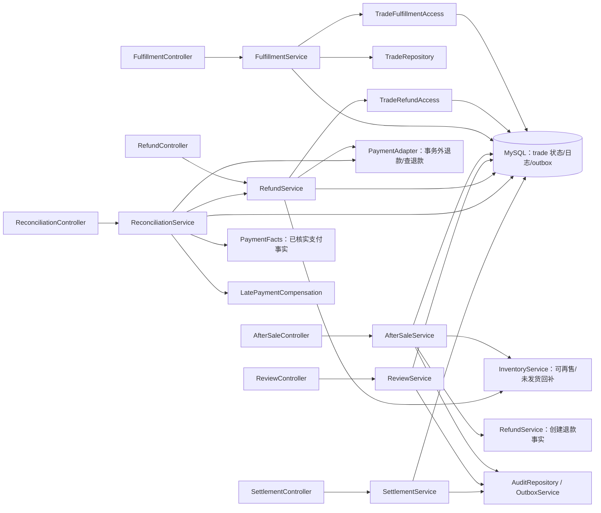

# 阶段 F：实际服务调用与锁边界

更新日期：2026-10-25。依据 `AGENTS.md`、01 FR-08—11 与业务政策、02 第 3—5 节、03 第 7—10 节、04 API-36—62/69/78—83/91、07 TC-15—23。接口字段和状态沿用基线；阶段 E 已记录的 V9 `refund.reason_type VARCHAR(32)` 决策不属于本阶段变更。工作目录不是 Git 仓库，无法核对提交差异或提供 commit SHA；代码图谱项目列表中没有本仓库，本阶段按 AGENTS.md 回退到文件搜索。

## 实际模块与调用关系

`FulfillmentService` 持有 shipment 与 shipment_item/event 写入；订单物流状态、订单状态日志和履约 Outbox 通过 trade 所有者 `TradeFulfillmentAccess` 修改。`RefundService` 持有 refund 及支付事实流程；订单退款累计、财务状态和未发货全额退款关单通过 `TradeRefundAccess` 修改，库存增量由 `InventoryService` 记录。`AfterSaleService` 维护售后状态与证据，并在当前事务中请求 RefundService 建立 refund。`ReviewService` 管理评价及审核留痕。`ReconciliationService` 管理对账批次和差异，不能直接改渠道金额。`SettlementService` 管理结算快照、调整与模拟出款。HTTP 层只做参数绑定、校验和调用服务。

支付/退款 HTTP 请求和查单均在事务外；服务先以本地事务接受并固定 paymentNo/refundNo 与处理中状态，再调用适配器，最后以独立事务锁定账本并核验单号、状态和精确金额。对账先提交 RUNNING 批次，在事务外逐笔查渠道，按本地交易事实应用或记录差异，最后单独结束批次。`LOCAL_MOCK` 属于本地集成测试；未执行真实支付宝沙箱或真实出款。

## 锁顺序与事务边界

所有写路径遵守 02：**会员/权限锚点（需要时）→ 订单 → 订单行 → SKU 库存（数值 ID 升序）→ 预占 → 财务明细**。不涉及的层可以跳过；跨订单按订单 ID 升序先锁全体订单，再锁全体订单行。事务内没有支付/退款 HTTP 调用；幂等快照、审计、Outbox 和业务账本与各自事务提交。

| 流程 | 数据库事务内实际锁与写入 | 事务外工作 |
|---|---|---|
| API-40 整体发货 | 锁当前用户及店铺授权 → 锁店铺订单 → 锁订单行 → 检查活跃售后与未退款发货数量 → 新建唯一 shipment、全部行数量快照和 SYSTEM 事件 → TradeFulfillmentAccess 按版本将 PAID 改 SHIPPED，写状态日志/Outbox → 审计、幂等结果 | 无第三方物流调用；一店订单一次整体发货 |
| API-38/39 订单查询/轨迹 | 先校验角色及商家/仓库店铺成员关系；写入轨迹时锁用户 → 订单 → 订单行 → shipment，再插入 MANUAL 事件及审计 | 无 |
| API-36 确认收货 | 锁用户 → 本人订单 → 订单行 → shipment；首次收货由 trade 所有者改 SHIPPED→COMPLETED 并写日志/Outbox，重复幂等键回放 | 无自动物流签收 |
| API-42—48 售后申请/本人查询/取消/寄回 | 申请锁用户 → 本人订单 → 订单行，检查售后窗口、退款余额和单行活跃申请；取消/寄回依次锁订单、订单行、售后行。文件凭证限定本人私有 AFTER_SALE_EVIDENCE | 无 |
| API-49—50 客服查看/审核 | 审核锁用户权限锚点 → 订单 → 订单行；批准未发货退款时再按 SKU 升序锁库存、预占、支付行，最后锁售后并创建唯一 refund；退货批准只设回寄期限，不创建退款 | 不执行退款渠道请求 |
| API-51 退货验收 | 锁用户/仓库授权 → 订单 → 订单行 → SKU 升序 → 预占 → 售后；拒收只留验收记录，接受且可再售时按售后业务键一次回补并记库存流水，然后创建 refund；不可再售不回补 | 无 |
| API-52/53 退款查询/执行 | 执行受理阶段锁用户权限锚点 → 订单 → 订单行 → SKU/预占 → payment/refund/售后财务事实，存 PROCESSING 和受理幂等快照。成功应用阶段独立重锁相同订单资源后校验状态、refundNo/paymentNo/金额；未发货路径只在退款成功时回补，TradeRefundAccess 更新 item/order 的退款累计及财务状态，更新 refund/售后、审计/Outbox | 调用 refund 或先以原 refundNo 查单/重试；未知保持 PROCESSING，FAILED 可用原 refundNo 与新的执行键重试。用户回跳不确认退款 |
| API-54—57 对账/差异 | RUNNING 事务按 provider＋账期唯一；单笔事实应用/差异写入锁订单 → 订单行 → SKU/预占 → payment/refund/issue；解决差异时同样先锁关联订单资源再锁 issue；完成批次时锁 reconciliation_run | 查单/查退款逐笔在事务外进行；无渠道凭据或无任何账单证据时不声称真实支付宝对账通过 |
| API-58—62 结算与模拟出款 | 创建时按 shop/账期唯一候选集，按订单 ID 排序锁订单，再锁订单行和关联售后、退款、差异、既有结算明细/调整；二次核验资格后保存每订单快照和账期汇总。审核及出款根据快照引用重复锁订单资源与相关财务行，校验版本、创建/审核人分离、当前资格及账平衡。正余额才可模拟出款；PAID 与明细由数据库触发器拒绝更新/删除 | 不调用银行或真实资金渠道；只生成 MOCK 出款凭证 |
| API-37/69/91 评价 | 创建锁会员 → 完成订单 → 订单行，校验 30 天窗口、未全额退货退款、每行唯一；审核锁会员 → review，写状态、理由、审核人及审计 | 无 |

结算候选使用北京时间账期截止，要求订单已完成且售后窗口结束；排除所有活跃售后、CREATED/PROCESSING/FAILED 退款、OPEN 差异、已占用结算明细和 PENDING 调整。按订单净额收取 3%，逐订单 HALF_UP 到分并冻结明细。后续退款不得重写 PAID 历史单；经证据和独立审核的差额以新账期 adjustment 抵扣。非正余额不能批准或出款，未出款负余额可结转到后续账期。

## 本阶段数据库与接口状态

V10 只新增阶段 F 需要的 shipment、shipment_item、shipment_event、settlement、settlement_item、settlement_adjustment 六张表和 PAID/已应用记录保护触发器；不回写 V1—V9。现行 `contracts/openapi.yaml` 和 [阶段 F 契约清单](F-接口契约清单.md) 由 `scripts/sync-contract.py` 生成，阶段 F 所列 API 已标记 IMPLEMENTED；全量清单仍保留 API-89 为 NOT_IMPLEMENTED，不代表任何虚假成功。

## 关键实现约束

- `ShipmentItem.shipped_quantity` 是发货时快照；退款不改写物流数量。订单 `status` 与 `financial_status` 分开维护。
- 未发货退款只有渠道确认成功后才回补；退货只在验收可再售时回补。`inventory_movement.business_key` 与状态检查保证各路径恰好一次。
- 每售后申请只建立一个 refund。渠道结果未知不改成功/失败、不释放相关业务占用。退款重试复用相同 refundNo。
- 对账 issue 只在留痕中记录说明/证据，不直接改支付或退款事实。结算调整金额必须符合原订单净应结额与已审核调整的差额。
- 操作权限从服务端权限与店铺成员关系解析；创建人与审批人分离。商家不能查询或修改其他店铺订单，公开评价只返回 VISIBLE。

阶段验证命令与逐项结果、证据路径、真实沙箱未执行原因以及下一阶段交接详见 [F-验证与交接.md](F-验证与交接.md)。
